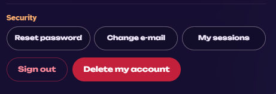
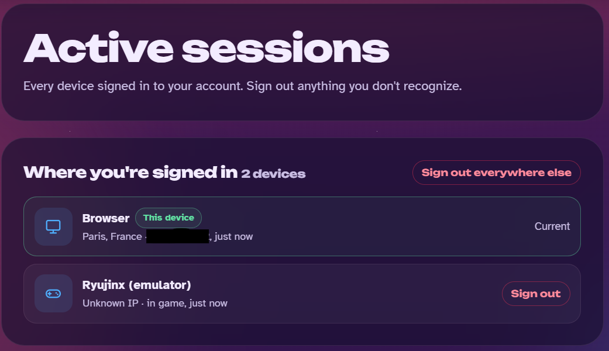

# DEN — Eden + Nextendo

**🇫🇷 Français** · [🇬🇧 English below](#-english)

DEN est un fork de l'émulateur Switch **[Eden](https://git.eden-emu.dev/eden-emu/eden)** pour **Android**, adapté pour se connecter à **Nextendo**, un réseau de jeu en ligne alternatif pour la Switch.

> Projet personnel et non officiel. Il n'est affilié ni à l'équipe d'Eden, ni à Citron, ni à Nextendo, ni à Nintendo.

<!-- DEN_PRIVATE -->
> [!IMPORTANT]
> ### 🔒 DEN est un projet privé
>
> DEN est **mon build personnel**, partagé uniquement avec la communauté de mon **[Discord de DEN](https://discord.gg/YjdS6wrbUj)**. Ce n'est pas un build officiel de Nextendo et il n'est pas soutenu par l'équipe de Nextendo.
>
> **Tout se passe sur le Discord de DEN** : aide, questions, bugs, nouveautés. **Merci de ne parler de DEN sur aucun serveur de Nextendo** (Discord, forum ou autre) et de ne pas leur demander de l'aide pour DEN : ils n'en sont pas responsables.

> [!IMPORTANT]
> ### 🚨 Tu as l'erreur **2306-0802** (« Unable to connect to the server ») ? Vérifie ces 6 points, dans l'ordre :
>
> 1. **Tu utilises la dernière version de DEN** : télécharge `DEN.apk` dans l'onglet [Releases](../../releases). Les anciens APK peuvent ne plus marcher en ligne.
> 2. **Ton fichier de compte est en place** : récupère `nextendo_account.txt` avec l'app **Orange** (sur le [Discord de DEN](https://discord.gg/YjdS6wrbUj)) et copie-le dans le dossier `files/config/` de DEN. S'il a expiré, refais-en un avec Orange. Être connecté sur le site ne suffit pas.
> 3. **Une seule session ouverte** : ferme le jeu **et** DEN sur tous tes autres appareils (autre téléphone, console, PC, autre émulateur). Un compte ne peut être en ligne qu'à un seul endroit.
> 4. **Compte lié au Discord Nextendo** (c'est la raison la plus fréquente du refus) : le jeu en ligne est réservé aux comptes liés à un compte Discord membre du [serveur Nextendo](https://discord.gg/nextendonetwork). Rejoins-le, appuie sur **« Vérifier mon compte »** dans le salon de vérification, puis connecte-toi sur verify.nextendo.network avec ton e-mail et ton mot de passe Nextendo ([guide](https://wiki.nextendo.network/guide/discord-link)). Quitter le serveur Discord supprime la liaison. Vérifie aussi que ton e-mail est confirmé sur [nextendo.network](https://nextendo.network).
> 5. **Après un plantage** : ferme DEN complètement, attends 2 à 3 minutes, puis relance.
> 6. **Vérifie que ta console apparaît côté Nextendo** : sur [nextendo.network](https://nextendo.network), clique sur ta photo de profil, puis **Sécurité → « My sessions »**.
>    Pendant que tu es en ligne dans un jeu, une ligne **« (emulator) · in game »** doit apparaître en plus du navigateur (le nom affiché peut être « Ryujinx (emulator) », c'est normal).
>    Si elle n'apparaît **jamais**, même avec un autre émulateur, le problème vient de ton **compte** et pas de DEN (vérifie d'abord le point 4 : la liaison Discord) : contacte l'équipe Nextendo sur leur [Discord](https://discord.gg/nextendonetwork) en leur donnant ton pseudo (uniquement pour ton **compte**, jamais pour parler de DEN).
>
> 
>
> 
>
> Toujours bloqué ? Envoie tes logs : ferme DEN, rouvre-le, puis **Paramètres → « Partager les logs de débogage »** (c'est le fichier `eden_log.txt.old`).

<table>
<tr><td align="center" width="50%"> Liste des jeux : joueurs en ligne et badge de mise à jour</td><td align="center" width="50%"> Menu Nextendo : amis, import de Mii, compte</td></tr>
<tr><td align="center" width="50%"> Mario Kart 8 Deluxe : mode en ligne</td><td align="center" width="50%"> Salon en ligne avec d'autres joueurs</td></tr>
<tr><td align="center" width="50%"> Mii importé dans le jeu</td><td align="center" width="50%"> Course en ligne à 60 FPS</td></tr>
</table>

## 💬 Communauté

Pour partager, poser tes questions, signaler un bug ou suivre les nouvelles versions de DEN, rejoins le **[Discord de DEN](https://discord.gg/YjdS6wrbUj)**. C'est là que je réponds, plutôt qu'en messages privés.

> Ce serveur est celui de **DEN**. Pour le compte et la liaison Discord de **Nextendo**, c'est toujours le [serveur Nextendo](https://discord.gg/nextendonetwork) qu'il faut rejoindre, mais **uniquement pour le compte** : toute question sur DEN se pose ici, pas chez eux.

## 🔑 Prérequis : un compte Nextendo

Pour jouer en ligne avec DEN, il te faut un **compte Nextendo gratuit**, à créer sur **[nextendo.network](https://nextendo.network)**. Sans compte, DEN fonctionne comme un émulateur Switch classique, mais ni le jeu en ligne ni la liste d'amis ne sont disponibles.

1. Crée ton compte sur [nextendo.network](https://nextendo.network) et **confirme ton adresse e-mail**.
2. Récupère ton fichier `nextendo_account.txt` avec l'app **Orange**, disponible sur le [Discord de DEN](https://discord.gg/YjdS6wrbUj) : tu te connectes à Nextendo dans ton navigateur (Orange ne voit jamais ton mot de passe), puis tu enregistres le fichier. Copie-le ensuite dans le dossier `files/config/` de DEN.
3. Fais cela **avant** de lancer un jeu : sans fichier de compte, le jeu affiche l'erreur **2306-0802**. Si ta session expire, le fichier est à refaire avec Orange.
4. Tu ne peux être en ligne que sur **un seul appareil à la fois** avec le même compte.

<!-- DEN_ACCOUNT_REQ -->
<!-- DEN_ORANGE_ONLY -->

## ✅ Ce qui fonctionne

- **Jeu en ligne sur Nextendo avec un fichier de compte généré par l'app Orange.** Voir « Jeux testés » ci-dessous.
- **Compte via l'app Orange** : le fichier `nextendo_account.txt` te connecte à Nextendo (identité, amis, présence) et DEN renouvelle ta session automatiquement tant que le fichier est valide.
- **Amis Nextendo** : ta liste d'amis est visible dans les jeux et dans l'écran « Amis Nextendo » (bouton dans l'en-tête de la liste des jeux), qui montre qui est en ligne et à quel jeu il joue. Tu peux aussi **ajouter un ami avec son code ami** (format `SW-1234-5678-9012`), **accepter ou refuser les demandes reçues** et **supprimer un ami** (appui long sur son nom). L'envoi de demandes d'ami a été testé et fonctionne.
- **Drapeau du pays dans Mario Kart 8 Deluxe** (menu « Drapeau du pays ») : ton drapeau s'affiche en ligne, avec le nom du pays. Pour la version 4.0.0 du jeu ; relance le jeu après avoir changé de drapeau.
- **Alerte si tu n'es pas connecté** quand tu lances un jeu Nextendo, qui te rappelle d'utiliser l'app Orange.
- **Compteur de joueurs en ligne** affiché en vert sur chaque jeu compatible.
- **Badge orange « MAJ x.y.z »** quand ta version du jeu n'est pas celle que Nextendo exige.
- **Import de Mii** (menu de la liste des jeux) : fichiers `.charinfo` / `.mii` et `MiiDatabase.dat` de Ryujinx.

## 🎮 Jeux testés

<!-- DEN_GAMES -->
Jeux testés et qui fonctionnent en ligne :

- ✅ Crash Team Racing Nitro-Fueled
- ✅ Mario Kart 8 Deluxe
- ✅ Super Mario Party
- ✅ Super Mario Maker 2
- ✅ Super Mario Party Jamboree
- ✅ Pokémon Légendes : Z-A
- ✅ Pokkén Tournament DX
- ✅ Super Smash Bros. Ultimate

Les autres jeux compatibles avec Nextendo devraient fonctionner aussi par défaut : **je vous invite à les tester** et à me faire un retour (idéalement avec le `eden_log.txt.old`) en cas de message d'erreur.

> 💡 **Pense à laisser les shaders se compiler** avant de jouer en ligne (lance le jeu et laisse-le charger ses shaders) : sinon les saccades peuvent provoquer des déconnexions en pleine partie.

## ⚠️ Ce qui ne fonctionne pas (encore)

- **Erreur 2306-0802 / « Unable to connect to the server »** : le plus souvent, ton fichier `nextendo_account.txt` est absent ou expiré (voir plus haut). Sinon, vérifie que ton adresse e-mail est confirmée sur nextendo.network, que ton compte est [lié à Discord](https://wiki.nextendo.network/guide/discord-link), qu'il est actif et que tu n'es pas déjà en ligne sur un autre appareil.
- **Pokémon Légendes : Z-A** (2.0.2) : le mode en ligne marche, mais rejoindre la room d'un ami peut être long ou échouer si l'un de vous a un réseau restrictif (Wi-Fi d'entreprise, données mobiles) ou est très loin. Réessaie en Wi-Fi, l'hôte restant sur l'écran de la room.
- **Pokémon Écarlate / Violet** : pas encore de jeu en ligne.
- **Splatoon 3** : le jeu se lance mais a des problèmes graphiques (limite connue).
- **Stabilité** : testé surtout sur **Retroid Pocket 5**. Un appareil en surcadençage ou qui chauffe peut avoir des chutes de FPS et des déconnexions. Les émulateurs Android sur PC (BlueStacks, etc.) ne sont pas recommandés : préfère un vrai appareil arm64.

## Installation

**Configuration requise : Android 13 minimum, appareil 64 bits (arm64).** Testé sur Retroid Pocket 5.

1. Télécharge **`DEN.apk`** dans l'onglet [Releases](../../releases) et installe-le (autorise les sources inconnues).
2. Ajoute **tes propres** jeux, clés et firmware, obtenus légalement depuis ta console. Ce dépôt ne distribue ni jeux, ni clés, ni firmware.
3. Ouvre DEN, **connecte-toi à Nextendo** depuis le menu, puis lance un jeu compatible.

> 🔒 DEN garde ta session dans `files/config/nextendo_account.txt` sur ton appareil. **Ne partage jamais ce fichier** : il contient un jeton qui donne accès à ton compte, comme un mot de passe.

## Compiler soi-même

Lance le workflow GitHub Actions **Build Android** (onglet *Actions*). L'APK sort dans l'artefact **DEN**.

## Crédits et licence

- **[Eden](https://git.eden-emu.dev/eden-emu/eden)** : l'émulateur de base (README d'origine : [README.eden.md](./README.eden.md)).
- **Citron** : inspiration pour certaines parties du support Nextendo.
- **yuzu** : le projet dont Eden est issu.
- **[alyeri/nextendo-mk8d-country-flags](https://github.com/alyeri/nextendo-mk8d-country-flags)** (licence MIT) : les patchs de drapeaux de pays pour Mario Kart 8 Deluxe, dont DEN reprend le format et les valeurs (voir [docs/THIRD_PARTY_NOTICES.md](./docs/THIRD_PARTY_NOTICES.md)).

Licence **GPL-3.0 ou ultérieure** (voir [LICENSE.txt](./LICENSE.txt)). Les mentions de copyright des fichiers d'origine sont conservées.

---

# 🇬🇧 English

DEN is a fork of the **[Eden](https://git.eden-emu.dev/eden-emu/eden)** Switch emulator for **Android**, adapted to connect to **Nextendo**, an alternative online gaming network for the Switch.

> Personal, unofficial project. Not affiliated with the Eden team, Citron, Nextendo or Nintendo.

> [!IMPORTANT]
> ### 🔒 DEN is a private project
>
> DEN is **my personal build**, shared only with the community of my **[DEN Discord](https://discord.gg/YjdS6wrbUj)**. It is not an official Nextendo build and it is not supported by the Nextendo team.
>
> **Everything happens on the DEN Discord**: help, questions, bugs, news. **Please do not talk about DEN on any Nextendo server** (Discord, forum or anywhere else) and do not ask them for help with DEN: they are not responsible for it.

> [!IMPORTANT]
> ### 🚨 Getting error **2306-0802** ("Unable to connect to the server")? Check these 6 things, in order:
>
> 1. **You use the latest DEN version**: download `DEN.apk` from the [Releases](../../releases) tab. Older APKs may no longer play online.
> 2. **Your account file is in place**: get `nextendo_account.txt` with the **Orange** app (on the [DEN Discord](https://discord.gg/YjdS6wrbUj)) and copy it into DEN's `files/config/` folder. If it has expired, make a new one with Orange. Being signed in on the website is not enough.
> 3. **Only one open session**: close the game **and** DEN on all your other devices (another phone, console, PC, another emulator). An account can only be online in one place.
> 4. **Account linked to the Nextendo Discord** (the most common reason for the refusal): online play is reserved for accounts linked to a Discord account that is a member of the [Nextendo server](https://discord.gg/nextendonetwork). Join it, press **"Verify my account"** in the verification channel, then sign in on verify.nextendo.network with your Nextendo e-mail and password ([guide](https://wiki.nextendo.network/guide/discord-link)). Leaving the Discord server removes the link. Also check that your e-mail is confirmed on [nextendo.network](https://nextendo.network).
> 5. **After a crash**: fully close DEN, wait 2 to 3 minutes, then relaunch.
> 6. **Check that your console shows up on Nextendo**: on [nextendo.network](https://nextendo.network), click your profile picture, then **Security → "My sessions"**.
>    While you are online in a game, an **"(emulator) · in game"** entry must appear next to your browser (the name shown may be "Ryujinx (emulator)", that is normal).
>    If it **never** appears, even with another emulator, the problem comes from your **account**, not from DEN (check point 4 first, especially the Discord link): contact the Nextendo team on their [Discord](https://discord.gg/nextendonetwork) and give them your username (for your **account** only, never to talk about DEN).
>
> 
>
> 
>
> Still stuck? Send your logs: close DEN, reopen it, then **Settings → "Share debug logs"** (this is the `eden_log.txt.old` file).

<table>
<tr><td align="center" width="50%"> Games list: online players and update badge</td><td align="center" width="50%"> Nextendo menu: friends, Mii import, account</td></tr>
<tr><td align="center" width="50%"> Mario Kart 8 Deluxe: online mode</td><td align="center" width="50%"> Online lobby with other players</td></tr>
<tr><td align="center" width="50%"> Imported Mii in game</td><td align="center" width="50%"> Online race at 60 FPS</td></tr>
</table>

## 💬 Community

To share, ask questions, report a bug or follow new DEN versions, join the **[DEN Discord](https://discord.gg/YjdS6wrbUj)**. That is where I answer, rather than in private messages.

> This server is for **DEN**. For your **Nextendo** account and Discord link, you still need to join the [Nextendo server](https://discord.gg/nextendonetwork), but **for the account only**: any question about DEN goes here, not there.

## 🔑 Requirement: a Nextendo account

To play online with DEN you need a **free Nextendo account**, created at **[nextendo.network](https://nextendo.network)**. Without an account DEN works as a regular Switch emulator, but online play and the friends list are not available.

1. Create your account at [nextendo.network](https://nextendo.network) and **confirm your e-mail address**.
2. Get your `nextendo_account.txt` with the **Orange** app, available on the [DEN Discord](https://discord.gg/YjdS6wrbUj): you sign in to Nextendo in your browser (Orange never sees your password), then save the file. Copy it into DEN's `files/config/` folder.
3. Do this **before** launching a game: without an account file the game shows error **2306-0802**. If your session expires, make a new file with Orange.
4. You can only be online on **one device at a time** with the same account.

## ✅ What works

- **Online play on Nextendo with an account file made by the Orange app.** See "Tested games" below.
- **Account through the Orange app**: the `nextendo_account.txt` file signs you in to Nextendo (identity, friends, presence) and DEN renews your session automatically as long as the file is valid.
- **Nextendo friends**: your friend list is visible in games and on the "Nextendo Friends" screen (button in the games list header), which shows who is online and which game they are playing. You can also **add a friend with their friend code** (format `SW-1234-5678-9012`), **accept or decline incoming requests** and **remove a friend** (long-press their name). Sending friend requests has been tested and works.
- **Country flag in Mario Kart 8 Deluxe** ("Country flag" menu): your flag shows online, with the country name. For game version 4.0.0; restart the game after changing the flag.
- **Warning when you are not signed in** as you launch a Nextendo game, reminding you to use the Orange app.
- **Online player counter** shown in green on each compatible game.
- **Orange "UPDATE x.y.z" badge** when your game version is not the one Nextendo requires.
- **Mii import** (games list menu): `.charinfo` / `.mii` files and Ryujinx `MiiDatabase.dat`.

## 🎮 Tested games

Games tested and working online:

- ✅ Crash Team Racing Nitro-Fueled
- ✅ Mario Kart 8 Deluxe
- ✅ Super Mario Party
- ✅ Super Mario Maker 2
- ✅ Super Mario Party Jamboree
- ✅ Pokémon Legends: Z-A
- ✅ Pokkén Tournament DX
- ✅ Super Smash Bros. Ultimate

The other games compatible with Nextendo should work too by default: **please try them** and send me feedback (ideally with `eden_log.txt.old`) if you get an error message.

> 💡 **Make sure your shaders are compiled** before playing online (launch the game and let it finish loading its shaders): otherwise stutters can cause disconnections mid-match.

## ⚠️ What doesn't work (yet)

- **Error 2306-0802 / "Unable to connect to the server"**: most often your `nextendo_account.txt` file is missing or expired (see above). Otherwise check that your e-mail is confirmed on nextendo.network, that your account is [linked to Discord](https://wiki.nextendo.network/guide/discord-link), that it is active and that you are not already online on another device.
- **Pokémon Legends: Z-A** (2.0.2): online mode works, but joining a friend's room can be slow or fail if one of you is on a restrictive network (company Wi-Fi, mobile data) or very far away. Retry on Wi-Fi, with the host staying on the room screen.
- **Pokémon Scarlet / Violet**: no online play yet.
- **Splatoon 3**: the game launches but has graphical issues (known limitation).
- **Stability**: tested mainly on a **Retroid Pocket 5**. An overclocked or overheating device may see FPS drops and disconnections. Android emulators on PC (BlueStacks, etc.) are not recommended: use a real arm64 device.

## Install

**Requirements: Android 13 or newer, 64-bit (arm64) device.** Tested on a Retroid Pocket 5.

1. Download **`DEN.apk`** from the [Releases](../../releases) tab and install it (allow unknown sources).
2. Add **your own** games, keys and firmware, legally dumped from your console. This repository does not distribute games, keys or firmware.
3. Open DEN, **sign in to Nextendo** from the menu, then launch a compatible game.

> 🔒 DEN keeps your session in `files/config/nextendo_account.txt` on your device. **Never share this file**: it contains a token that gives access to your account, like a password.

## Build it yourself

Run the **Build Android** GitHub Actions workflow (*Actions* tab). The APK comes out in the **DEN** artifact.

## Credits and license

- **[Eden](https://git.eden-emu.dev/eden-emu/eden)**: the base emulator (original README: [README.eden.md](./README.eden.md)).
- **Citron**: inspiration for parts of the Nextendo support.
- **yuzu**: the project Eden descends from.
- **[alyeri/nextendo-mk8d-country-flags](https://github.com/alyeri/nextendo-mk8d-country-flags)** (MIT license): the country flag patches for Mario Kart 8 Deluxe, whose format and values DEN reuses (see [docs/THIRD_PARTY_NOTICES.md](./docs/THIRD_PARTY_NOTICES.md)).

Licensed under **GPL-3.0 or later** (see [LICENSE.txt](./LICENSE.txt)). Original copyright notices are preserved.
<!-- DEN_README_V2 -->
<!-- DEN_README_ERRBOX -->

<!-- DEN_README_SESSIONS -->

<!-- DEN_README_DISCORD -->
